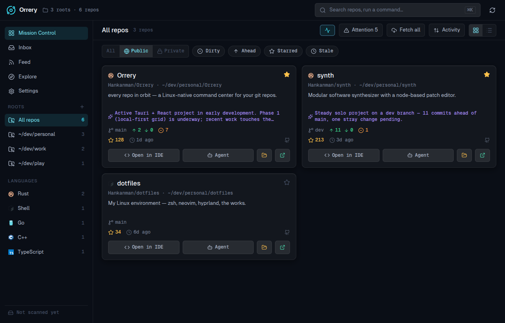
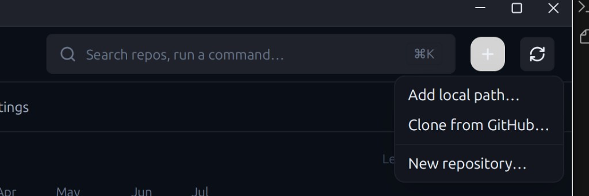
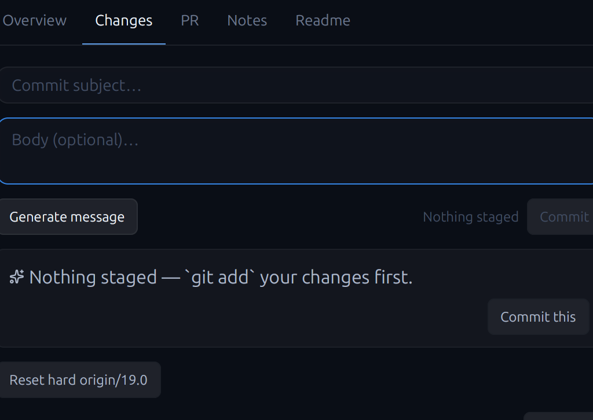
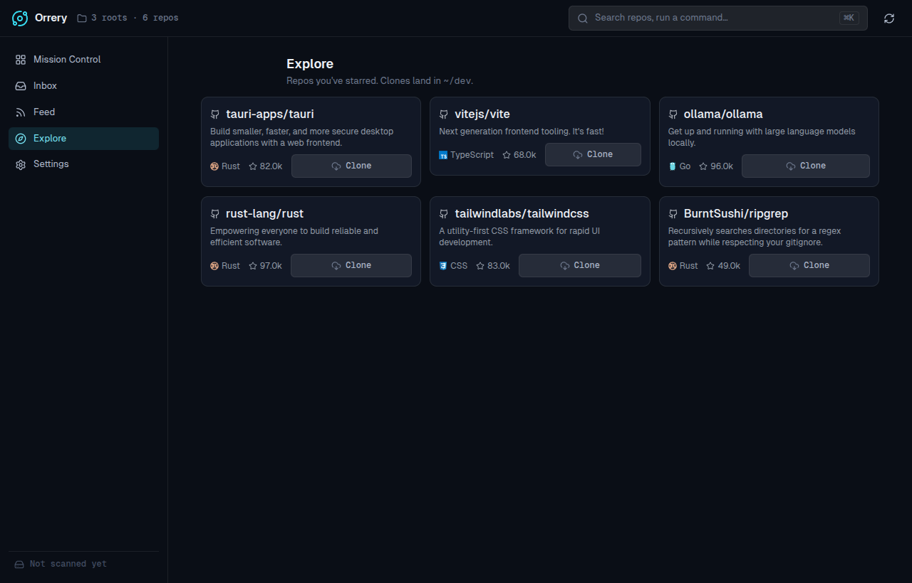
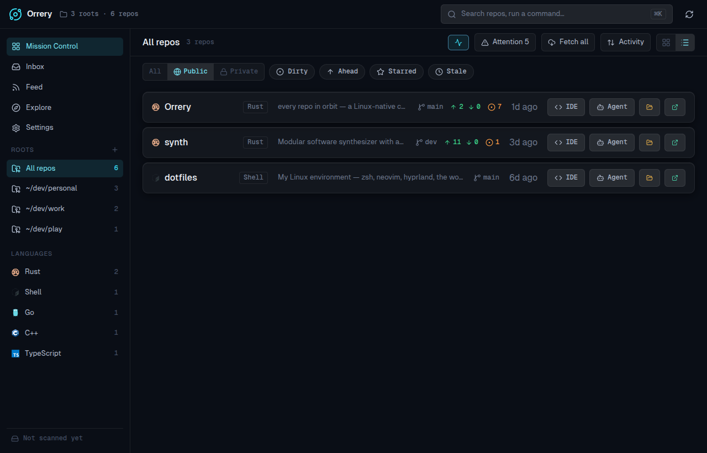

<div align="center">


# RepoHarbor

**Every repo at harbor. A Linux-native command center for your git fleet.**

A high-performance desktop dashboard built with **GPUI** (GPU-accelerated, zero webview, zero Tauri) for developers managing dozens or hundreds of repositories, nested submodule hierarchies, and multi-version workspace trees.

[](CHANGELOG.md)
[](https://www.rust-lang.org)
[-teal.svg)](#stack)
[](LICENSE)
[](https://azmykn.github.io/RepoHarbor/)

📖 **[Documentation & Feature Tour →](https://azmykn.github.io/RepoHarbor/)** · 📋 **[Changelog](CHANGELOG.md)** · ©️ **[Copyright & Contact](COPYRIGHT.md)**



</div>

---

> **Credit & Lineage:** Includes software originally published as **Orrery** by Seb Burrell (MIT). RepoHarbor is an independent product developed by **Digital Integrated Transformation Solutions (DigitsCode)**.

> **Architecture:** A native 64-bit Rust application built on **GPUI** (Zed's GPU-native UI framework) rendering directly via Vulkan over Wayland and X11. Fast, offline-first, instant local SQLite caching, with zero webview memory overhead.

---

## Table of Contents

- [Why RepoHarbor?](#why-repoharbor)
- [Key Capabilities & Feature Tour](#key-capabilities--feature-tour)
  - [1. Mission Control & Fleet Views](#1-mission-control--fleet-views)
  - [2. Submodule TREE & Hierarchy Management](#2-submodule-tree--hierarchy-management)
  - [3. Fleet Operations & Bulk Git Workflows](#3-fleet-operations--bulk-git-workflows)
  - [4. Deep-Dive Repository Drawer](#4-deep-dive-repository-drawer)
  - [5. One-Click Launchers & AI Coding Agents](#5-one-click-launchers--ai-coding-agents)
  - [6. Local-First On-Device AI](#6-local-first-on-device-ai)
  - [7. Multi-Host Forge Synchronization](#7-multi-host-forge-synchronization)
  - [8. Specialized Productivity Panes](#8-specialized-productivity-panes)
  - [9. Linux Desktop Integration](#9-linux-desktop-integration)
- [Screenshots](#screenshots)
- [Architecture & Tech Stack](#architecture--tech-stack)
- [Building & Installation](#building--installation)
- [Configuration Reference](#configuration-reference)
- [Performance & Design Philosophy](#performance--design-philosophy)
- [License, Copyright & Contact](#license-copyright--contact)

---

## Why RepoHarbor?

If you manage enterprise software, multi-module platforms (such as Odoo ecosystems, microservices, or firmware suites), you likely have **hundreds of git checkouts**, complex nested submodules, and multiple staging branches scattered across your drive. 

Existing tools fall short:
- **GitKraken / SmartGit**: Resource-heavy, single-repo focused, or trapped behind proprietary licensing.
- **GitHub Desktop**: Webview-based, single-repo, with no official Linux support.
- **Terminal CLI**: Powerful for single operations, but painful for fleet-wide situational awareness, bulk synchronization, and discovering broken states across dozens of workspaces.

**RepoHarbor solves this.** It scans your designated directories, discovers all active repositories and submodule trees, fuses local git states with host metadata (GitHub/GitLab) and local AI analysis, and renders the entire fleet at 60/120+ FPS on your GPU.

---

## Key Capabilities & Feature Tour

### 1. Mission Control & Fleet Views

- **High-Density Virtualized Grid & List**: Seamlessly scales to 500+ repositories with zero scroll jitter or memory bloat. Toggle between dense grid cards and structured compact list rows.
- **Work Modes**:
  - **Needs me**: Intelligent attention queue surfacing actionable items — pending pull request reviews, broken CI builds, merge conflicts, pull-only dirty violations, and open issue mentions.
  - **Behind**: Filters exclusively to repositories lagging behind remote upstreams.
  - **Working**: Filters to active repositories with uncommitted changes, staged index edits, or unpushed commits.
  - **All**: Complete workspace overview with fast pagination and live counters.
- **Contextual Status Chips**: Instant filtering by `Dirty` (unstaged changes), `Stageable` (ready to index), and `Pushable` (commits ahead of upstream).
- **Multi-Faceted Search & Filtering**: Filter in real time by name, relative path prefix, primary programming language, workspace group, or natural language semantic queries.
- **Sorting Options**: Order by recent commit timestamp, repository name, or ahead/behind deviation.

### 2. Submodule TREE & Hierarchy Management

- **Nested Submodule Discovery**: Automatically parses `.gitmodules` and checks out submodule parent-child relationships across all scan depths.
- **Sidebar Submodule TREE**: Displays an expandable tree of parent checkouts and their child submodules.
- **Noise Reduction**: Child submodules are cleanly hidden from the top-level fleet grid by default, preventing visual clutter while remaining fully inspectable.
- **Scoped Family Inspection**: Clicking any parent in the sidebar immediately scopes the grid view to that parent repository and its submodule children.

### 3. Fleet Operations & Bulk Git Workflows

- **Context-Aware Fetch & Pull Toolbar**:
  - **When repositories are selected**: The `Fetch` and `Pull` buttons act specifically on the selected set with exact counts (e.g., `Fetch (4)`, `Pull (4)`).
  - **When nothing is selected**: Acts across all visible repositories in the active filter.
- **Bulk Submodule Update**: One-click **Update submodules** discovers and fast-forwards all declared submodules on their configured branches, surfacing clean per-path status toasts.
- **Pull Behind**: A dedicated fleet action that pulls every repository that is behind upstream in a single atomic pass.
- **Selection-Gated `Actions ▾` Menu**:
  - **Stage all / Discard changes**: Bulk stage or restore working tree changes.
  - **Commit… / Fast Commit**: Create bulk commits with prompt guidance.
  - **Push / Fetch / Pull**: Coordinated remote operations across selected trees.
  - **Merge branch into HEAD…**: Batch-merge a specified target branch into current HEAD across multiple repositories simultaneously.
  - **Prune & Hard Reset**: Clean up dead branches or reset to upstream tracking branches.
- **Pull-Only Upstream Tree Protection**: Configure directory prefixes for vendor or upstream cores (e.g., framework bases, libraries) that should receive automated pulls but are strictly protected from accidental local commits or force pushes.

### 4. Deep-Dive Repository Drawer

Clicking any card or list row slides out a comprehensive, high-speed inspection drawer with three dedicated tabs:

#### A. Work Tab (Pending Changes & Diff)
- **Staged & Unstaged Lists**: Color-coded modification badges (`M`odified, `A`dded, `D`eleted, `R`enamed, `?` Untracked).
- **Full Absolute File Path Copying**:
  - The inline copy button on each row and diff header copies the **full absolute path** on disk (e.g., `/home/user/projects/module/file.rs`) directly to your clipboard.
  - Context menu offers dedicated choices: **Copy full path**, **Copy relative path**, and **Copy file name**.
- **One-Click File Launch Actions**:
  - **Open file**: Launches the file directly in the system's default handler via `xdg-open`.
  - **Open in IDE**: Opens the specific file directly inside your configured IDE (`ideCommand`).
  - **Open location**: Opens the containing folder in the system file manager and reveals/selects the file via standard Linux D-Bus (`org.freedesktop.FileManager1.ShowItems`).
- **Interactive Syntax-Highlighted Diff**: In-drawer diff viewer with per-hunk inspection, copy diff button, and line budget limiting for responsive rendering.
- **Fast Commit & AI Generation**:
  - Enter commit subject and body with one-click **Fast commit**.
  - **Gen only**: AI generates semantic commit subjects and descriptions by analyzing staged/unstaged unified diffs.
  - **Gen & push**: Generates commit message, commits working changes, and pushes to remote in one automated flow.
  - **External Diff Tool**: Opens `meld`, `code --diff`, or your configured diff GUI on the entire repository with a single click.
- **Branch Switcher & Quick Merge**:
  - Checkout local or remote tracking branches.
  - One-click `[merge]` button directly merges any selected branch into the current HEAD.
  - Active merge conflicts surface an **[Abort merge]** button to safely restore pre-merge state.

#### B. History Tab
- Chronological commit timeline with author avatars, abbreviated hashes, commit subjects, relative timestamps, and diff statistics.

#### C. About Tab
- Rendered Markdown README view, remote URLs, disk size, license detection, branch count, and upstream tracking status.

### 5. One-Click Launchers & AI Coding Agents

Every repository card and drawer footer serves as a rapid launcher configured to your favorite tools:
- **IDE Launchers**: Pre-configured templates with brand logos for **VS Code**, **Cursor**, **Zed**, **CLion**, **PyCharm**, **IntelliJ IDEA**, **Sublime Text**, and custom commands.
- **Terminal Coding Agents**: Launch autonomous terminal agents with prompt injection:
  - Supports terminals: **Ptyxis**, **Ghostty**, **Kitty**, **Alacritty**, **WezTerm**, **Foot**, **GNOME Terminal**.
  - Integrates with coding agents: **Claude Code**, **Aider**, **Codex**, **OpenCode**, and custom scripts.
- **Native File Manager**: One-click folder icon opens the repo in your desktop file manager (Nautilus, Dolphin, Nemo, Thunar).
- **Forge Remote**: Instant jump to the repository's web page on GitHub or GitLab.

### 6. Local-First On-Device AI

- **100% Private & Local**: Communicates directly with local [Ollama](https://ollama.com) instances or bundled `llama.cpp` backends. No source code or proprietary diffs leave your machine.
- **Semantic Commit Messages**: Summarizes working tree changes into concise, conventional commit messages.
- **Repo Purpose Summaries**: Generates high-level project overviews from READMEs and directory structure.
- **Semantic Codebase Search**: Natural language query indexing powered by local embedding models (e.g. `nomic-embed-text`).
- **Strict `aiReady` Gating**: When AI services are offline, unreachable, or disabled in settings, every AI button and badge hides cleanly, ensuring zero interface lag or error prompts.

### 7. Multi-Host Forge Synchronization

- **GitHub & GitLab (Public & Self-Hosted)**: Direct REST/GraphQL integration over secure `rustls`.
- **Token Security First**: Forge authentication tokens are strictly scoped and egress-gated — tokens are only sent to verified domains (`github.com`, `gitlab.com`, or user-whitelisted self-hosted domains), never to arbitrary remotes.
- **PR & Review Status**: Surfaces open pull requests, review requests, mergeability checks, and CI pipeline outcomes directly on repository cards and in the Inbox.

### 8. Specialized Productivity Panes

- **Inbox**: Central triage station for open pull requests, pending code reviews, failed CI runs, and issues requiring your attention.
- **Feed**: Social timeline and release announcements for followed repositories and upstream dependencies.
- **Explore**: Browse and search your starred GitHub/GitLab repositories with one-click cloning into your local workspace roots.
- **Cleanup**: Housekeeping view identifying merged local branches, obsolete tracking branches, and orphan checkouts with bulk deletion.
- **Agents**: Live process monitor that scans `/proc` to surface active AI coding sessions (Claude Code, Aider, etc.) running on your system.
- **Dev Tools**: Built-in developer utility suite with JSON formatters, regex analyzers, color swatch pickers, base64 encoders, and hash calculators.

### 9. Linux Desktop Integration

- **GPU Acceleration**: Rendered on the GPU using Vulkan via GPUI's `blade` backend with sub-millisecond input latency.
- **System Theme & Accent Matching**: Automatically synchronizes with system dark/light modes and desktop accent colors via D-Bus (`zbus`) portals on GNOME and KDE.
- **System Tray (StatusNotifierItem)**: Runs quietly in the system tray via `ksni`, showing a live attention counter badge and a quick-open menu for favorite repositories.
- **Command Palette (`Ctrl+K` / `⌘K`)**: Universal fuzzy launcher to navigate repos, switch workspaces, trigger git verbs, and run actions from anywhere.
- **KRunner & Desktop Portals**: Native desktop search provider integration for KDE environments.

---

## Screenshots

<p align="center">
  
  &nbsp;
  
</p>

<p align="center">
  
  &nbsp;
  
</p>

---

## Architecture & Tech Stack

RepoHarbor is organized as a three-crate Cargo workspace under `crates/`:

```
crates/
├── repoharbor-core/         # Pure logic: repo discovery, libgit2 ops, forge sync, SQLite, AI, launch
│   ├── scan.rs git_ops.rs   # Filesystem scanning + libgit2 worktrees, branches, hunks, merges
│   ├── forge.rs inbox.rs    # GitHub/GitLab REST & GraphQL clients (reqwest + rustls)
│   ├── cache.rs             # Embedded SQLite database (rusqlite) for offline state and fast boot
│   ├── ai.rs llama.rs       # Ollama REST client & llama.cpp bindings (summaries, commit messages)
│   ├── launch.rs            # Desktop process launcher, file opener, D-Bus file manager reveal
│   └── config.rs model.rs   # Configuration schemas and unified fleet data models
├── repoharbor-platform/     # Linux desktop integration (no UI)
│   ├── appearance.rs        # D-Bus portal theme and accent color tracking
│   ├── tray.rs              # System tray StatusNotifierItem implementation (ksni)
│   ├── notify.rs watcher.rs # Desktop notifications and inotify filesystem monitoring
│   └── agents.rs            # /proc scanner detecting live AI terminal sessions
└── repoharbor/              # Native GPUI application & executable binary
    ├── main.rs shell.rs     # Application setup, navigation, horizontal tab bar, layout
    ├── card.rs drawer/      # RepoCard components, full drawer views, diff inspection, quick merge
    ├── fleet.rs             # Multi-repo batch operations (fetch, pull, merge, stage, commit)
    ├── palette.rs           # Ctrl+K fuzzy Command Palette
    ├── views/               # Inbox, Feed, Explore, Cleanup, Agents, DevTools, Settings
    └── theme.rs             # Tokenized design system with custom GPU-tinted SVG icons
```

| Layer | Implementation | Notes |
|---|---|---|
| **UI Framework** | [GPUI](https://www.gpui.rs) | Zed's GPU-native desktop UI framework (Rust, no Chromium) |
| **Rendering** | `blade` (Vulkan) | Hardware accelerated rendering direct to Wayland/X11 surface |
| **Git Engine** | `git2` (libgit2 vendored) | In-process native git operations without CLI overhead |
| **Persistence** | SQLite (`rusqlite` bundled) | Instant sub-second startup, cached forge data, offline resilience |
| **Networking** | `reqwest` + `rustls` | Multi-host REST & GraphQL with strict token egress boundaries |
| **Local AI** | [Ollama](https://ollama.com) / `llama.cpp` | On-device inference for commit messages and semantic search |
| **Linux Desktop** | `zbus` + `ksni` | System theme/accent auto-detection, tray icon, notification portals |

---

## Building & Installation

### Prerequisites

RepoHarbor requires a modern **Rust** toolchain (stable) and native Linux graphics/desktop development libraries:
- Vulkan loader and headers
- Wayland client libraries and/or XCB
- `libxkbcommon` and `libxkbcommon-x11`
- `fontconfig` and FreeType
- C/C++ compiler, `cmake`, and `pkg-config`

Run the automated setup script for your Linux distribution:
```bash
bash scripts/setup.sh
```

### Build Commands

```bash
# Build all workspace crates
cargo build --workspace

# Run the native desktop application
cargo run -p repoharbor

# Run the test suite (315+ automated unit tests)
cargo test --workspace

# Enforce strict Clippy lint checks
cargo clippy --workspace --all-targets -- -D warnings

# Check code formatting
cargo fmt --all -- --check
```

### Release Packages

Release builds (`.deb`, `.rpm`, `.AppImage`) are automatically produced via Cargo packaging tools:
```bash
# Build optimized release binary
cargo build --release -p repoharbor

# Generate Debian package (.deb)
cargo deb -p repoharbor

# Generate RPM package (.rpm)
cargo generate-rpm -p repoharbor

# Build standalone AppImage
packaging/appimage.sh
```

---

## Configuration Reference

RepoHarbor stores its configuration in standard XDG paths (`~/.config/repoharbor/config.toml`). An annotated example:

```toml
# Directories scanned recursively for git repositories and submodules
roots = [
    "~/projects/core",
    "~/projects/custom",
    "~/projects/tools"
]

# Maximum directory depth to traverse during scanning
scanDepth = 3

# Directory names skipped during repository discovery
ignore = [
    "node_modules",
    ".cache",
    "vendor",
    "target",
    "dist",
    ".git"
]

# IDE launcher command template ({path} is replaced with the repo or file path)
ideCommand = "cursor {path}"

# Terminal & coding agent launch template
agentCommand = "ptyxis --new-window -d {path}"
agentDispatchArgs = "{prompt}"

# External visual diff tool template
diffCommand = "meld {path}"

# Host Authentication
githubClientId = ""
githubAllowCliToken = true
gitlabHosts = ["gitlab.com"]

# Local On-Device AI Configuration
aiEnabled = true
aiBackend = "cloud"              # "cloud" (OpenAI-compatible) or "ollama"
aiModel = "gpt-oss:20b"
ollamaHost = "http://localhost:11434"
embedModel = "nomic-embed-text:latest"

# Desktop Notifications
notifyEnabled = true
notifyNewPr = true
notifyReviewRequested = true
notifyCiFailure = true
notifyAttention = true
notifyAgentFinished = true

# UI Layout Preferences
layout = "grid"                   # "grid" or "list"
sidebarCollapsed = false
sidebarWidth = 280.0

# Upstream vendor paths: automated pulls allowed, pushes strictly prevented
pullOnlyPrefixes = [
    "~/projects/core",
    "~/projects/upstream-framework"
]

# Workspace Groupings for custom sidebar filtering
[[workspaceGroups]]
name = "Enterprise · Core"
prefixes = ["~/projects/core"]

[[workspaceGroups]]
name = "Enterprise · Custom"
prefixes = ["~/projects/custom"]
```

---

## Performance & Design Philosophy

1. **Flat Design is a Performance Contract**: Avoids heavy drop-shadows, blurred backdrops, and multi-pass compositor filters. The interface uses high-contrast elevation borders and solid surface tokens (`--orr-*`) to guarantee zero GPU stalls.
2. **GPU UI Direct to Compositor**: By using GPUI and Vulkan, RepoHarbor eliminates Chromium process trees, IPC serialization overhead, and DOM layout reflow bottlenecks.
3. **In-Process Git**: Uses embedded `libgit2` bindings for indexing, diffing, and hunk generation, bypassing the process-spawn overhead of shell-based git commands.
4. **Cache-First Boot**: Launches and paints in under 200ms by reading the local SQLite snapshot before initiating non-blocking background filesystem scans.

See [`docs/rendering-performance.md`](docs/rendering-performance.md) for full benchmarks and architectural comparisons.

---

## License, Copyright & Contact

Released under the **[MIT License](LICENSE)** for public use — you are free to use, copy, modify, merge, publish, distribute, sublicense, and sell copies, provided the copyright and permission notices are preserved.

| Field | Detail |
|---|---|
| **Product** | **RepoHarbor** |
| **Version** | `2026.10.8` (Calendar versioning `YYYY.M.P`) |
| **Publisher** | **Digital Integrated Transformation Solutions (DigitsCode)** |
| **Author** | **Azmy Karam** |
| **Repository** | [https://github.com/azmykn/RepoHarbor](https://github.com/azmykn/RepoHarbor) |
| **Documentation** | [https://azmykn.github.io/RepoHarbor/](https://azmykn.github.io/RepoHarbor/) |
| **Email** | [azmykn@gmail.com](mailto:azmykn@gmail.com) |
| **Phone** | [+966559622034](tel:+966559622034) |

See **[COPYRIGHT.md](COPYRIGHT.md)** and **[NOTICE](NOTICE)** for the full public distribution notice.
